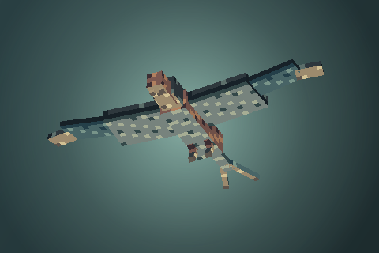
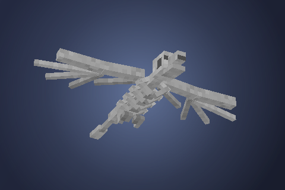
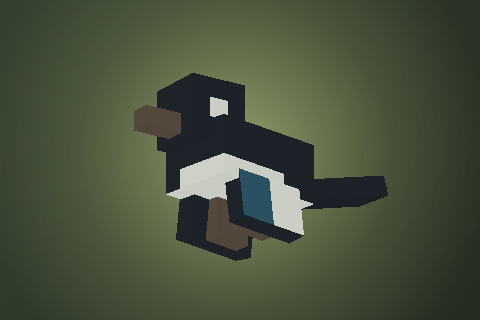
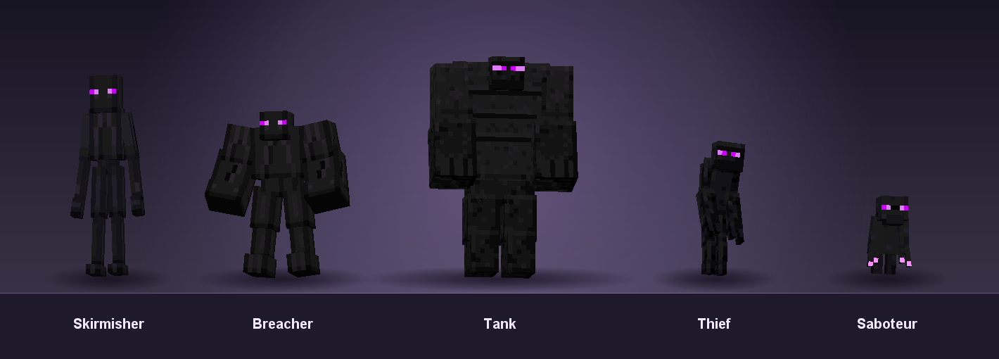

# ZedsTekkitOverhaul

A **Minecraft 1.2.5** overhaul for **Tekkit Classic 3.1.2**. Territory grows more dangerous as you spend time in it, full moons bring assaults, and the Overworld gives you new reasons to prepare, fortify, and explore.

## Survival 0.5.1-alpha.2 · The Abyss Below

**Pending owner graphical acceptance.** New Default Overworld oceans can contain the Abyssal Trench, with deep terraces, fossil formations, clustered marine life and weathered masonry. The Motorboat and diving equipment support expeditions to the biome. [World generation and owner walkthrough](docs/engineering/abyssal-worldgen.md) · [Decorative palette](docs/engineering/abyssal-decoration.md)

## Survival 0.5.1-alpha.1 · Water exploration

**Alpha preview.** Headless Tekkit Classic checks cover diving equipment, oxygen charging, distillation and Motorboat operation. In-game visual and audio checks are tracked in the [owner playtest checklist](docs/engineering/local-artwork-recovery.md#owner-playtest).

- **Diving equipment.** The Underwater Mask improves visibility in water with the matching ZTOAgent. The Oxygen Tank provides a finite air supply, and Flippers improve swimming.
- **Air Compressor.** The IC2 low-voltage machine recharges Oxygen Tanks. Its grille faces the player when placed, and its panel shows remaining charge and stored EU.
- **Fractional Distillation.** The refinery has connected vessels, indicators and positional audio driven by actual processing, and updated controls in the classic Minecraft and IC2 palette. The existing seven-block arrangement still forms the refinery.
- **Motorboat.** Fit an outboard to a vanilla boat for faster ocean travel. Sneak-right-click to fill its 4,000 mB ZTO Gasoline tank and collect the empty bucket. The propeller spins under thrust and reverses with the engine. Dismantle the boat to recover the hull and its remaining fuel. [Recipes and controls](docs/engineering/motorboat.md)

The default `local-dev` build restores the approved refinery and Air Compressor artwork for Tekkit Dev. The explicit `public` profile packages the public artwork baseline. [Artwork profiles](artwork/README.md#build-profiles)

[Underwater playtest walkthrough](docs/agents/survival-051-alpha1.md#validation-and-owner-walkthrough) · [Distillation walkthrough](docs/engineering/distillation-industrial-presentation.md#verification-and-owner-walkthrough)

## Survival 0.4.0-alpha.4 · Fortress warfare

- **Site sieges.** Eligible full moons can bring a limited force to a recognized settlement. Walls, cover and bridges shape its approach. Infantry can try another route, and Breachers can switch to a nearby wooden entrance. Structural breaching is opt-in.
- **Ground and aerial survivors.** High-intensity sieges can send a Skelebird into exposed airspace. Living attackers remain in the world after reinforcements end and can survive chunk unload and Save/Quit.
- **Natural encounters and manual tests.** Natural site sieges are enabled by default when `playerAssault` is on. Set `experimentalSiteSieges=false` to opt out and keep ordinary lunar assaults eligible. In singleplayer, open **Numpad 1 → SITE_SIEGE** to call or cancel a manual test and inspect the approach, reinforcements and battlefield census.

[Playtest walkthrough](docs/agents/survival-040-acceptance.md#owner-playtest) · [Acceptance and native pack results](docs/agents/survival-040-acceptance.md#final-stabilization-evidence) · [Settings](docs/agents/configuration.md)

## Survival 0.3.0-alpha.4 · Settlements and shelter

- **Settlement Recognition.** Construction, movement and utility use can establish a persistent site. Connected evidence can link a house and workshop across a short courtyard while keeping a nearby independent outpost separate. Existing site IDs carry forward from alpha.3 saves.
- **Protected Interior.** A separate local assessment shows overhead cover, enclosure and a route to exposed ground. Opening a door can change protection while the site keeps its identity. Terrain, lighting and the existing encounter rules still govern spawning.
- **Debug Hub.** In singleplayer, press **Numpad 1 → Settlement Recognition**. Cycle through **Assessment**, **Survey & Storage** and **Protection** to inspect the site, survey coverage and local geometry.

[Playtest walkthrough](docs/agents/survival-030-alpha4.md#owner-walkthrough) · [Implementation, verification and SITE_SIEGE handoff](docs/agents/survival-030-alpha4.md) · [Changelog](CHANGELOG.md)

## Survival 0.2.3-alpha.2 · Biome ecology and industrial survival

| Fugl | Skelebird | Magpie |
| :---: | :---: | :---: |
|  |  |  |
| Aerial predator that circles and dives. Passing Fugls can hunt exposed chickens. | Nocturnal skeletal hunter that crosses low over exposed ground. | Forest bird that perches, scavenges, and occasionally steals one recoverable seed or feather. |

*Portraits rendered from the game's models and textures.*

- **Underground ecology.** Caves favor ordinary Enderkin within the native hostile spawn budget. The biome still shapes which roles appear.
- **Industrial survival.** Saboteurs can dismantle exposed transport, and on Normal and Hard, Breachers can force open wooden doors and fence gates. Fuel gets priority when Shift-clicked into supported furnaces.
- **Mining.** The experimental vein mining gesture is suspended. Survival mining uses the original tool costs and drop rules.

[Biome ecology and wildlife](docs/agents/survival-023-implementation.md) · [Industrial Saboteur](docs/agents/saboteur-industrial.md) · [Fieldwork and verification](docs/agents/survival-023-alpha2-fieldwork.md) · [Changelog](CHANGELOG.md)

## Survival 0.2.1 · The Enderkin bestiary



*The full bestiary, rendered from the same models and textures used in the game.*

| Enderkin | Encounter |
| --- | --- |
| **Skirmisher** | Repositions with short blinks and telegraphs a ranged Ender Pulse. |
| **Breacher** | Closes distance, reaches low platforms, and can force open wooden entrances on Normal and Hard. |
| **Tank** | Commits to heavy frontal strikes. On Hard it can open localized breaches in suitable walls when pursuit stalls. |
| **Thief** | Steals an item from your inventory or hotbar and flees. Recover the loot by intercepting it or finding its cache. Sneak with a vanilla compass for a temporary **Ender Trail** toward the last recorded location. |
| **Saboteur** | Briefly disrupts supported machinery. It can also dismantle one eligible exposed BuildCraft, Additional Pipes, IC2 or RedPower transport component and flee with it. |

All five have Creative spawn eggs and can appear in ordinary Overworld Survival with ZTOAgent. Press **Numpad 1** in singleplayer to open the Debug Hub and inspect current territorial activity, ordinary hostile pressure, and lunar encounter decisions. [Survival guide](docs/agents/survival-021-implementation.md) · [Changelog](CHANGELOG.md) · [Integration results](docs/agents/survival-021-integration.md)

## Gameplay

- **Territorial threat** raises the ordinary hostile cap with sustained activity. Activity decays while you are away, and ordinary spawning still checks terrain and lighting.
- **Lunar Cycle** persists eight phases per save. Full-moon assaults and smaller patrols occur on natural lunar boundaries. Terrain, cover, and available population space shape each encounter. [Lunar Cycle](docs/agents/lunar-cycle-implementation.md)
- **Industry and alchemy** include directional Hoppers, IC2-powered fractional distillation with BuildCraft connections, and an Alchemical Converter that feeds IC2 from EE2 collectors. [Hopper](docs/engineering/hopper-backport.md) · [Distillation](docs/agents/distillation.md) · [Alchemical power](docs/engineering/alchemical-power-v1.md) · [EMC profiles](docs/engineering/emc-profile.md)
- **Inventory and crafting** include a Creative inventory with tabs and search, recipe preparation, drag distribution, and Shift-click armor equip in supported screens. [Creative inventory](docs/engineering/creative-inventory-backport.md) · [Inventory gestures](docs/engineering/inventory-drag.md)

## Install on Tekkit Classic

Use **Tekkit Classic 3.1.2** and **Java 8**. Close Prism and Minecraft, then install the two matching build artifacts into **Tekkit Dev** from the workspace root.

```powershell
.\zto-tools\install-zto-prism.ps1 -Instance "$env:APPDATA\PrismLauncher\instances\Tekkit Dev"
```

The installer adds `ZedsTekkitOverhaul.jar` to the instance and registers `ZTOAgent.jar` as a managed Prism component. The agent enables settlement placement, removal and utility observations, territorial spawning, natural Enderkin substitutions, custom moon rendering, inventory gestures, and supported direct industrial hooks. [Installation and staging](docs/deploy-prism.md)

Edit `minecraft/config/ZedsTekkitOverhaul.cfg` with Minecraft closed to tune territorial pressure, ordinary Enderkin spawning, and lunar encounters. [Settings and migration](docs/agents/configuration.md)

## Build from source

Use **FoxyRetroMDK 1.3.6**, **MCP 6.2**, and **JDK 8**. The development environment uses Forge **3.4.9.171**. The supported Tekkit pack runs Forge **3.3.8.164** and FML **2.2.106.176**.

```powershell
.\zto-tools\build-and-deploy.bat
```

With Prism and Minecraft closed, the default build verifies the approved `local-dev` artwork and installs the matching mod and agent in **Tekkit Dev**. Select `ZTO_ARTWORK_PROFILE=public` explicitly to build redistribution artifacts without installing them. Keep the original obfuscated Tekkit mod JARs in the separate pack runtime. [Build profiles and deployment](docs/deploy-prism.md)

## Project resources

- [Project vision](PROJECT_VISION.md) and [contributor handbook](docs/agents/README.md)
- [Survival playtest checklist](docs/agents/survival-021-integration.md#owner-verification) and [compatibility evidence](docs/agents/compatibility-acceptance.md)
- [Developer diagnostics and disposable-world testing](docs/agents/test-automation.md)
- [Tekkit Classic API reference](docs/reference/tekkit-classic-3.1.2/README.md) and [asset credits](CREDITS.md)
