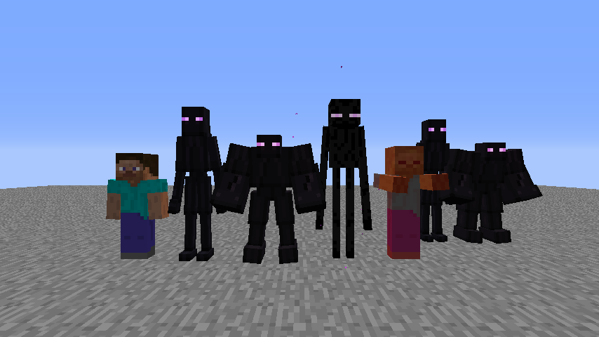
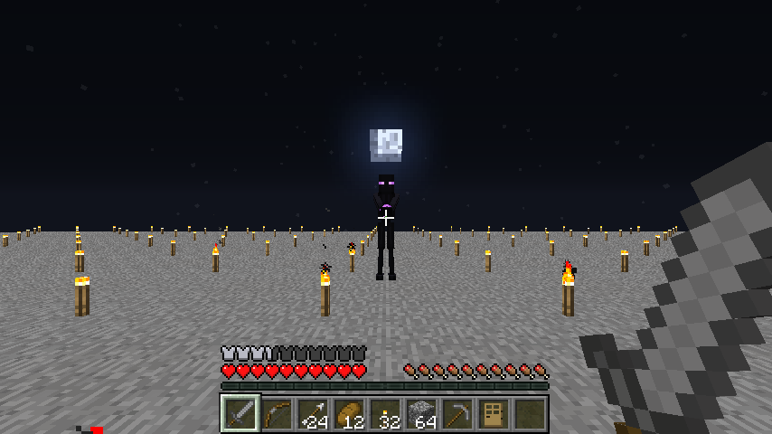
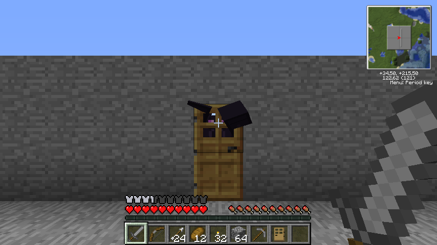

# ZedsTekkitOverhaul

A **Minecraft 1.2.5** overhaul for **Tekkit Classic 3.1.2** that connects industry, alchemy and automation. Its singleplayer lunar calendar gives survival a rhythm of calm nights and occasional assaults.



## Survival Foundations · Alpha.8 complete

**0.1.0-alpha.8** closes the Survival Foundations milestone. Full-moon assaults, lunar patrols and experimental Enderkin encounters give the Overworld a rhythm of preparation, danger and recovery. [Changelog](CHANGELOG.md) · [Alpha.8 playtest and verification](docs/agents/survival-alpha8.md)

| Under the full moon | At the door |
| --- | --- |
|  |  |
| A Skirmisher winds up its Ender Pulse during a mixed lunar assault. | A Breacher pressures the entrance and leaves the door intact. |

**Next up: 0.2 · Territorial Activity & Threat.** The next milestone explores how local activity and regional danger can shape encounters. [Territorial design](docs/agents/territorial-threat-design.md)

## Gameplay

### World and automation

- **Lunar Cycle** persists eight phases per single-player save. New worlds begin at new moon, and existing worlds retain their initial vanilla phase. An optional launch agent displays the calendar phase in the native sky. Gameplay modules can read snapshots and subscribe to transitions. [Lunar Cycle guide](docs/agents/lunar-cycle-implementation.md)
- **Lunar Player Assault** stages three waves of vanilla mobs when a full-moon night begins naturally in the local Overworld. The default budget is 15 and the active assault cap is 8. Listen for a cave sound at dusk, then fight in the open, prepare a shelter, or retreat. [Rules, tuning and acceptance](docs/agents/survival-assault-alpha2.md)
- **Lunar Patrols** add up to two vanilla hostiles on the first quarter and three on the waxing gibbous. Patrols and assaults can spawn in lit fields with open approaches. Roofs and physical boundaries can keep special encounters outside. [Outdoor pressure and fortification](docs/agents/survival-alpha6.md)
- **Mob equipment** gives selected lunar Zombies and Skeletons visible, persistent equipment. Zombie swords increase melee damage, armor provides protection, and Skeletons retain their native bow. Lunar loadouts carry no added loot. [Encounter loadout rules](docs/agents/survival-alpha5.md)
- **Enderkin prototypes** include the Skirmisher, which casts a violet Ender Pulse, and the Breacher, which strikes closed barriers without breaking them. Both have Creative eggs. An off-by-default option lets them replace selected slots in lunar encounters. [Configuration and playtest](docs/agents/survival-alpha8.md)
- **Hopper** adds five persistent slots, directional item transfer, loose-item pickup, redstone locking and a dedicated GUI. The backport includes support for selected IC2 and BuildCraft inventory interactions. [Asset setup and compatibility](docs/engineering/hopper-backport.md)
- **Fractional distillation** uses an IC2 LV heater to process oil, with BuildCraft oil and water intake, four placeable petroleum fractions and live component panels. [Distillation guide](docs/agents/distillation.md)

### Alchemy and energy

- **Alchemical Converter** draws EMC from adjacent EE2 collectors and supplies the IC2 network on free faces. Right-click with an empty hand to see its buffer and connections. [Converter guide](docs/engineering/alchemical-power-v1.md)
- **EE2 fuels** can power IC2 generators. **EMC profiles** let you audit and override values for supported items across the pack. [EMC profiles](docs/engineering/emc-profile.md) · [Coverage audit](docs/engineering/emc-coverage-audit.md)

### Inventory

- **Creative inventory backport** adds tabs, search and a player inventory view. The **1.2.5** tab opens the classic screen, and **F6** restores the backport by default. [Asset setup and controls](docs/engineering/creative-inventory-backport.md)
- **Inventory tools** add recipe preparation and drag support for compatible modded containers. Drag uses a separate launch agent. [Crafting and inventory guide](docs/agents/crafting-inventory-ux.md)

## Build and run

Use **FoxyRetroMDK 1.3.6**, **MCP 6.2**, **JDK 8** and the legacy ModLoader API. MCP compiles with Forge **3.4.9.171**; Tekkit Dev runs pack Forge **3.3.8.164** and FML **2.2.106.176**. From the MDK root, with Minecraft closed, run the deployment script.

The current build identifier is **0.1.0-alpha.8**. See the [changelog](CHANGELOG.md) and [versioning policy](docs/agents/VERSIONING_POLICY.md).

```powershell
.\zto-tools\build-and-deploy.bat
```

The script expects the isolated PrismLauncher instance `Tekkit Dev` under `%APPDATA%\PrismLauncher\instances\Tekkit Dev\minecraft\mods`. See [deployment documentation](docs/deploy-prism.md) for overrides, prerequisites and safeguards.

### Create an assault playtest world

With Tekkit Dev closed and the MCP client compiled, run the generator.

```powershell
.\zto-tools\new-assault-playtest.ps1
```

Open **Lunar Assault - Playtest** in Normal difficulty. It starts in Survival on open terrain with a stone sword, bow, arrows, leather armor, food and shelter supplies. The full-moon assault is due in about 1 minute 50 seconds at 20 TPS. Use `-Name 'Lunar Assault - Shelter'` to create a separate trial. [Setup and playtest checklist](docs/agents/survival-assault-alpha2.md#owner-playtest-world)

### Try mob equipment

The opt-in viewing pen in **Tekkit Dev** puts equipped Zombies and Skeletons beside ordinary ones in a marked disposable save. Use the fixture setup to inspect the gear, observe combat and try Save and Quit followed by reopening the world. [Disposable viewing pen setup](docs/agents/MOB_EQUIPMENT_BACKPORT_SPEC.md#disposable-viewing-pen)

### Optional features

- **Moon rendering:** run `.\zto-tools\build-lunar-agent.bat` and add `-javaagent:<absolute-path-to-ZTOLunarAgent.jar>` to Tekkit Dev's Java 8 arguments. The agent can run alongside the inventory agent. Unsupported renderer fingerprints keep the native phase selection.
- **Configuration:** Edit `minecraft/config/ZedsTekkitOverhaul.cfg` while the game is closed. Alpha.8 imports settings and registry IDs on first startup. [Settings and migration](docs/agents/configuration.md)
- **Lunar Debug:** set `lunarDebugKey=67` in `config/ZedsTekkitOverhaul.cfg` for F9. The default `0` disables the shortcut. Optionally set `lunarVerboseLogging=true` for transition logs. Restart after changing these settings.
- **Lunar encounter settings** are in the same config. Use `lunarPatrols=false` to disable patrols, `playerAssault=false` to disable full-moon assaults, or `lunarOutdoorLightPressure=false` to restore alpha.5 placement. Older configs with `assaultSpawnBudget=6` need an explicit change to 15 to use the current default. Set `survivalDebugHud=true` to see encounter timing, insertions and placement constraints with F10. Restart after editing the config. [Patrols](docs/agents/lunar-pressure.md) · [Assault settings](docs/agents/survival-assault-alpha2.md#tuning-and-compatibility) · [Outdoor placement](docs/agents/survival-alpha6.md)
- **Dev Bridge diagnostics** run over authenticated loopback. Add `-Dzto.dev=true -Dzto.devBridge.enabled=true` to Tekkit Dev. Give `zto-tools/zed-dev.ps1` the discovery path from the log to query the clock, loaded blocks, inventory, supported machines and lunar transitions. Keep the discovery file private. [Diagnostics guide](docs/agents/dev-bridge.md)
- **Opt-in acceptance automation** additionally requires `-Dzto.devBridge.testing=true` and a marked disposable save. Run `zto-tools/zed-test.ps1 list` to discover scenarios and the current `singleplayer-core` suite. Each run checks the candidate JAR hash and writes a JSON report. [Setup and commands](docs/agents/test-automation.md) · [Acceptance matrix](docs/agents/singleplayer-acceptance.md)

**Important:** the original production Tekkit mod JARs are obfuscated. Placing IC2/EE2 release JARs directly into the deobfuscated MCP runtime can cause class-loading failures. Test full mod integration in the separate PrismLauncher instance; see [environment notes](docs/agents/environment.md).

## Project resources

Original source and assets live under `src/minecraft/zed/`. Build and test scripts live under `zto-tools/`. Minecraft, the MDK and third-party mod archives are distributed separately.

- [Contribution and agent instructions](AGENTS.md)
- [Architecture and testing handbook](docs/agents/README.md)
- [Tekkit Classic 3.1.2 API reference](docs/reference/tekkit-classic-3.1.2/README.md)
- [Asset credits](CREDITS.md)
