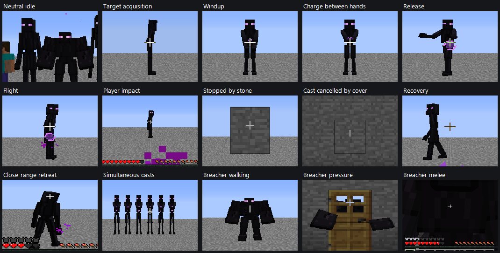
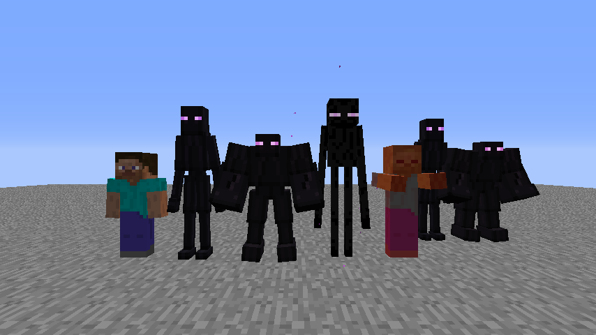
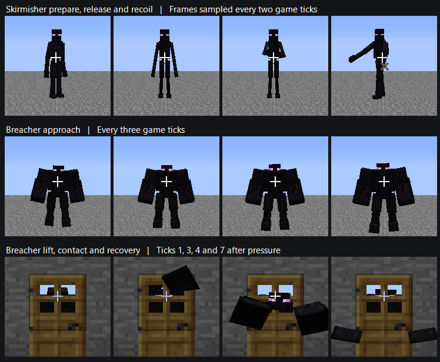
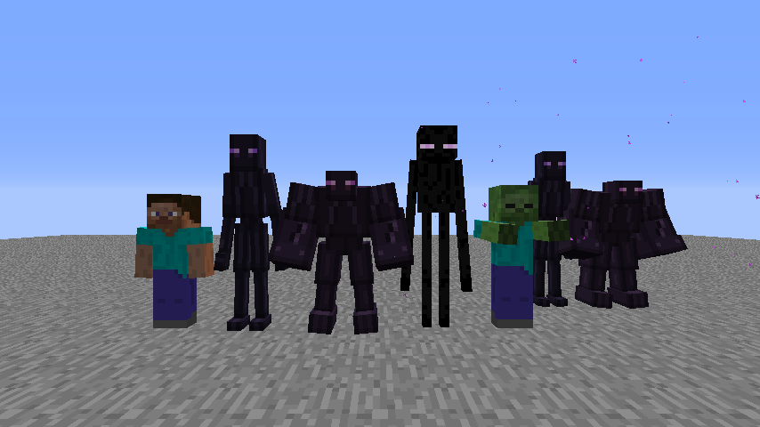

# Enderkin visual design

The two alpha.7 prototypes share obsidian skin, a cubic face with two violet eyes, and limbs whose proportions hint at a connection to the Enderman. The designs keep the origin unexplained and make the two tactical roles readable from a distance.

| | Skirmisher | Breacher |
| --- | --- | --- |
| Standing silhouette | About 2.7 blocks tall, with a narrow chest, pinched waist, long legs and a forward-set face | About 2.2 blocks tall, with a recessed head, broad shoulder mass, oversized forearms and planted feet |
| Palette | Cool near-black with lilac eyes | Warm near-black with muted forearm fissures and pink-violet eyes |
| Motion | Offset strides and knees, shoulder lag, lateral lean, hands converging around a charge and opening on release | Slow weight transfer and delayed fists, two-arm pressure strike and asymmetric melee |

The installed Minecraft 1.2.5 atlas uses `#000000` and `#161616` for the body and a separate eye pass with `#CC00FA` and `#E079FA`. The original Enderkin atlases keep their existing face and limb layouts. Their skin now clusters around the vanilla body tones, with small cool or warm differences for anatomy. Each eye mask contains four opaque pixels and shares the model UVs. The eyes draw at full light with alpha testing, no additive blending, and scoped lighting and texture state.

| Atlas | Skin, darkest through highlights | Accents | Eyes |
| --- | --- | --- | --- |
| Skirmisher, 64×64 | `#08080A`, `#101015`, `#15141B`, `#1B1A22`, `#211D2A` | `#251A2E`, `#2B2333` | `#B764DC`, `#E4A4FA` |
| Breacher, 128×64 | `#090809`, `#111013`, `#17141A`, `#1D181F`, `#241D27` | `#281A27`, `#2C222E` | `#CB6ECF`, `#ECB1F0` |

The old knees bent at the hard zero crossing of the thigh swing, shoulders shared the leg phase, and the Breacher used its two-arm lift for both attacks. Eased knee lifts, ankle follow-through and phase delays between the shoulder and elbow soften the repeated cycles. Small independent head and shoulder motions fade into the walking and attack poses. The Skirmisher prepares its shoulders, then extends its arms during the existing twelve-tick aim. The shot starts a recoil pulse while the draw pose eases out. Its lateral tilt uses observed displacement across the gaze direction. The Breacher loads its shoulders before a two-arm barrier strike, releases its fists through contact and settles into recovery. Its melee strike drives one arm forward with torso rotation. The barrier sound is scheduled four ticks after the existing pressure event, at the visual contact keyframe. The AI pressure count, route checks and melee damage use their original timing.

Collision remains 0.60×1.70 and 0.85×1.90 blocks. The loaded-block probe blends vertical compression over 0.35 blocks outside the hull footprint and scales about the feet. The mesh can visibly shorten under a two-block roof. Vertical movement around abrupt ledges, vanilla collision-box culling, and the gap between rendered and selectable height remain limitations. Stable save names, lunar placement and encounter loadouts are independent of the model. Pose state is transient and exercised in local singleplayer.

## Ender Pulse casting

The Skirmisher settles its stride as it angles its shoulders in. Its elbows approach the hands' shared center at slightly different rates. A small pulse core then forms between the hands and grows to the release pose. The shot event opens the hands and drives the follow-through as the torso unloads. Cover and close pressure drain charge through the existing pose interpolation. A shortened stride and small hip drop limit foot lift on the planted part of the cycle. The pulse launches from the hand region at normal standing height. Since the ceiling adjustment is render-only, the visible casting point may sit lower under a low roof.

The traveling form uses an untextured faceted core in `#301844`, `#492567` and `#643382` with two broken contours in `#DC79F5` and `#9C4ACD`. Its axis follows velocity, with rotation around that axis and slight changes in contour radius and spacing. The same scaled mesh represents the charge. The mesh is full-bright with world depth testing. It adds no light to surrounding blocks. Impact leaves four brief violet specks.

The Breacher carries its hands slightly closer during the drop and folds its elbows further at impact to reduce the amount of fist visible through a closed door. The arc is still fixed, so close camera angles and certain door orientations can reveal intersection.

[Pulse by torchlight](images/ender-pulse-torchlight.png) · [Pulse in low light](images/ender-pulse-low-light.png)

The combat captures use the natural aim and release at the fixture's eight-block engagement distance. The pulse fixture sets a deterministic heading for the player and wall impacts and the two night exposures. The near-side impact specks are occluded by stone when viewed from the protected side. The frame sequence shows the silhouette and timing. Owner playtesting remains the measure of perceived weight, ground contact and readability while the camera is moving.

## Reproduction

Deploy with `zto-tools/build-and-deploy.bat` using the workspace copy of Tekkit Dev. Run `test-alpha7-runtime.ps1` with `-Mode visual`, `-Mode combat` and `-Mode stress`. Each run uses a separate marked disposable save. The visual fixture positions a player, the two Enderkin, an Enderman, a Zombie and a second pair of Enderkin at a fixed camera distance. The fixture hides the reference Zombie's fire overlay for a clear daylight comparison. It captures daylight, torchlight, low light and a two-block ceiling. The combat fixture captures gameplay-driven poses and reloads the two entities through Save and Quit. The logs identify each capture in the isolated game's `screenshots` directory.

## Polish in Tekkit Dev

The daylight and torchlight scenes show two near-black bodies alongside the vanilla Enderman. The Skirmisher keeps a slightly cooler cast. The Breacher's larger forearms retain a few warm accents. In low light, the rectangular eye masks remain visible as the bodies recede into shadow.

[Torchlight](images/enderkin-polish-lineup-torchlight.png) · [Low light](images/enderkin-polish-lineup-low-light.png) · [Two-block ceiling](images/enderkin-polish-two-block-clearance.png)

The [strafe](images/enderkin-polish-skirmisher-strafe.png), [melee](images/enderkin-polish-breacher-melee.png) and [reopened Creative save](images/enderkin-polish-creative-reopened.png) use the same candidate. The door sequence shows the main remaining visual artifact. Both arms can project through the door panel because the pose follows a fixed swing arc. The probe checks the sound dispatch tick and captures adjacent poses. It does not measure audio playback delay or subjective weight. Owner playtesting should assess foot contact and turning in a moving view.

The polished visual and 12-entity stress fixtures pass on the runtime archive identified in [alpha.7 acceptance](survival-alpha7.md#polish-acceptance). Under load, the harness observed 139 sampled transitions over 7.441 seconds. This includes the whole client and rendering.

## Baseline evidence

- The visual and stress fixtures passed on commit `5df8c12c3a7708c79164511c832ba28ab62596f0`, JAR SHA-256 `da44191327ada8326ca5b0589c08908941b985958e306521630f56c3753392b7`. Two unrelated untracked documents account for the build's dirty flag. The stress fixture kept twelve active mobs for 140 game ticks. Both fixtures checked native renderer lookup, texture upload and stable texture IDs. Frame captures also checked for OpenGL errors.
- The combat fixture passed on the same JAR after fixing the harness to wait for both doorway traversal and melee damage. It verified Skirmisher spacing, retreat, aim and cover cancellation, Breacher pressure and melee, both health values after Save and Quit, then death and removal.
- The isolated Tekkit Classic 3.1.2 client ran Minecraft 1.2.5, Forge 3.3.8.164, FML 2.2.106.176 and Java 1.8.0_51. MCP 6.2 compiled and reobfuscated the client with development Forge 3.4.9.171. The archive passed the 280-entry streaming ZIP check and contains the models and both atlases.
- All six alpha.6 runtime modes passed on the first candidate archive, SHA-256 `c6f263ff33272017d90f3704838b2a1d2dcf75141a22a814450de17386faa659`. Its sidecar recorded base `9e1d2bdaffbe9a912ea8219ee1d9d6ac0f32bd6f` with the redesign in the working tree. Every non-directory JAR entry other than the provenance file matches the subsequent commit build byte-for-byte. Portable calendar, assault and patrol schedules, outdoor approaches, OBJ loader and legacy lightmap checks also passed.
- This environment still logged obsolete resource URL failures and the pre-existing EMC initialization warning for item 169. Owner playtesting and remote multiplayer animation synchronization remain open.

## Baseline in-game comparisons

Left to right in the daylight lineup are the reference player, Skirmisher, Breacher, vanilla Enderman, Zombie and a second Enderkin pair. The Skirmisher reaches nearly to the Enderman's head with a narrower chest and a more forward pose. The Breacher reads as lower and wider even when its eye color is hard to see.

[Torchlight](images/enderkin-lineup-torchlight.png) · [Low light](images/enderkin-lineup-low-light.png) · [Two-block ceiling](images/enderkin-two-block-clearance.png)

The two-block capture shows the compressed pair under the roof and a second pair at full standing height in the open. The reference Enderman flashes red because the fixture holds it underneath the same roof.

- Skirmisher [windup](images/enderkin-skirmisher-windup.png), [release](images/enderkin-skirmisher-release.png) and [repositioning](images/enderkin-skirmisher-strafe.png).
- Breacher [pursuit](images/enderkin-breacher-pursuit.png), [lift at the closed door](images/enderkin-breacher-pressure-windup.png), [downstroke](images/enderkin-breacher-pressure.png) and [melee](images/enderkin-breacher-melee.png). The door partially occludes both pressure poses.
- [Both prototypes after reopening the save](images/enderkin-reopened.png) and the [twelve-entity stress fixture](images/enderkin-stress.png).
