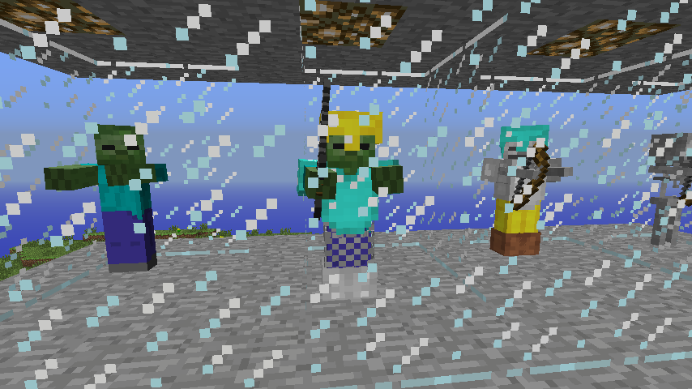
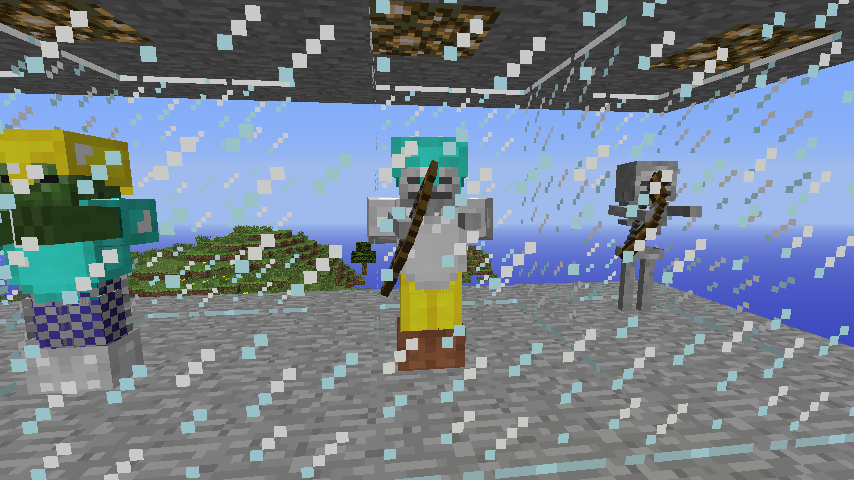

# Mob equipment compatibility and acceptance

Target candidate `0.1.0-alpha.3` for Minecraft 1.2.5 and Tekkit Classic 3.1.2. The implementation contract and fixture are in the [backport specification](MOB_EQUIPMENT_BACKPORT_SPEC.md).

## Compatibility decision

Audited the actual MCP 6.2 client sources and `conf/client.srg`, then inspected the effective Prism Tekkit Dev classpath using the selected jar-mod ahead of the 1.2.5 base client. The selected jar-mod and `minecraft/bin/modpack.jar` both hashed to SHA-256 `0827ee55325fedbc37f2a6a890f19db11f75fab5e9a5c02eafd1bd50d2b59446`. The development source profile is Forge 3.4.9.171. The runtime log identifies Forge 3.3.8.164, FML 2.2.106.176 and OptiFine 1.2.5 HD S C6. The overlay includes NEI and its patched inventory classes.

| Area | MCP source and effective runtime ABI |
| --- | --- |
| Vanilla combat | Zombie `ajg` and Skeleton `xr` extend Mob `yy`, Creature `aaa`, Living `acq` and Entity `nn`. The base client provides both concrete mob classes and their combat tasks. Zombie's collide task `ax` calls `attackEntityAsMob(Entity)`, runtime `yy.c(Lnn;)Z`, with native attack strength 4 and potion modifiers. Skeleton's ranged task `sf` creates an arrow directly with its target and a 60-tick interval. |
| Special held items | `getHeldItem()` is `acq.ae()Laan;`. Skeleton `xr` and pigman `alt` override it with stock bow and golden sword respectively. Pigman extends Zombie, so equipment eligibility checks the exact class. The normal biped renderer still draws those native stacks. |
| Persistence | Overlay Entity `nn` exposes `getEntityData()Lady;`. Its `writeToNBT` and `readFromNBT` are `nn.d(Lady;)V` and `nn.e(Lady;)V` and write/read `ForgeData` alongside the vanilla state before dispatching to `b(Lady;)V` and `a(Lady;)V`. The existing `EntityList` mapping still loads the original entity IDs and classes. |
| Damage and loot | OptiFine's overlay Living `acq` calls `forge.ForgeHooks` through `Reflector`. `damageEntity` at `acq.c(Lmd;I)V` calls `onEntityLivingHurt(Lacq;Lmd;I)I` before `applyArmorCalculations` at `acq.d(Lmd;I)I`. The latter reads the native armor value from `au()I` and respects bypass sources. `onDeath` at `acq.a(Lmd;)V` collects stock loot through `a(ZI)V` and dispatches `onEntityLivingDrops(Lacq;Lmd;Ljava/util/ArrayList;IZI)V` before insertion. Skeleton's override calls the Living death method. The same registration and handler descriptors exist in both inspected Forge profiles. |
| Rendering | Overlay `RenderManager` (`ahu`) initializes both stock mob entries with overlay `RenderBiped` (`tg`). Its held-item path is `tg.b(Lacq;F)V`. Base `RenderLiving` (`fe`) supplies armor-pass selection `b(Lacq;IF)I`. Overlay `RenderPlayer` (`we`) establishes the stock armor paths, pass order and thinner leggings model. FML passes its renderer map to `BaseMod.addRenderer(Map)`, then initializes registered renderers. NEI's `gb.class` belongs to the installed overlay. |

Register one legacy Forge handler and wrap only the two stock biped renderer entries through FML. Use the original renderer directly for ordinary mobs and subclasses. If either renderer entry already belongs to a different renderer type, skip that registration and log the conflict. The equipment feature ships no class replacements, transformers, entity registrations or resource packs.

## Runtime evidence

### Candidate provenance

| Field | Value |
| --- | --- |
| Starting `main` verified against GitHub | `8e7679181015b54b1e7fb4c581f7feb8318189f6` |
| Tested source commit | `ab1223fe34c7fe0089cdc2c47510e9007b6139d4` |
| Product version | `0.1.0-alpha.3` |
| Build dirty flag | `true` for the pre-existing untracked `APPROVED_SURVIVAL_RELEASE_ROADMAP.md` and `TEST_AUTOMATION_SPEC.md`. Tracked files were clean at build time. |
| Build UTC | `2026-11-12T10:27:04.0942708Z` |
| JAR SHA-256 | `51832afc06498cf647527cd9e1fceaa241db4a80b26f7878a78b0e16943e81b9` |
| Compile | JDK 8u504, MCP 6.2, Forge 3.4.9.171 |
| Runtime | Java 8u51, Minecraft 1.2.5, Tekkit Classic 3.1.2, Forge 3.3.8.164, FML 2.2.106.176, OptiFine 1.2.5 HD S C6 |

MCP client compilation and reobfuscation passed. The package streamed all 251 entries and archive inspection found every class under `zed/`. The portable lunar calendar and assault schedule checks passed.

The live probes ran on a separate copy of isolated Tekkit Dev with the same merged pack, Java 8 runtime and existing inventory and lunar agents. The hashes of 18 relevant classes in the merged client matched the effective installed overlay and base-client order. Equipment used marked save `ZTO-Test-19db7581123a4532a168bf7e868d2d37` with Dev Bridge and the Survival Debug HUD off. The probe checked the running ZTO code source and exercised the native game thread. The candidate hash was checked before each launch.

| Case | Status | Observed |
| --- | --- | --- |
| Visible Zombie and Skeleton gear | PASS | Screenshots show the iron sword, native bow, four armor layers on each mob and unmodified comparison mobs. |
| Melee damage | PASS | The ordinary and iron-sword Zombies dealt 4 and 6 HP respectively to fresh unarmored vanilla living targets and to the unarmored player on Normal. |
| Incoming protection | PASS | An 8 HP player hit removed 7 HP from the bare Zombie and 2 HP from the equipped Zombie. The bare and armored Skeleton lost 8 and 4 HP. |
| Native ranged behavior | PASS | The armored and ordinary Skeleton each spawned real arrows attributed to the correct shooter through the existing AI. Both rendered the native bow pose. |
| Save and Quit and reopen | PASS | The same four original entities loaded after the world was reopened from the title screen. All eight armor pieces and the iron sword's ID, count, damage value 7 and custom tag returned. There were zero owned gear drops before save and after reopen. |
| Equipment drops | PASS | Player kill and lethal fall produced nine owned stacks total. Replaying both death callbacks and advancing world ticks added no owned drops. |
| Despawn | PASS | The legacy direct removal path for a stone-sword Zombie emitted no gear. The save/reopen case also exercised world unload. |
| Ordinary mobs | PASS | The comparison mobs kept their usual empty hand or bow, base damage/protection and stock renderer. Five fresh ordinary Zombies and five Skeletons dropped five rotten flesh, six arrows and four bones total. The pigman retained its gold sword and was outside equipment scope. Rare loot rates were outside the bounded sample. |
| Startup without diagnostics | PASS | The pack opened the equipment world with Dev Bridge and Survival Debug HUD disabled. A separate title-screen smoke run had the fixture off as well, opened zero listening sockets and shut down gracefully. |
| Lunar assault regression | PASS | In marked save `ZTO-Test-8afb9123d99c4b36a1374f8326b13704` on Hard, natural dusk at raw tick 205,000 started the assault. Wave 1 opened at 205,100 and placed 4/4 vanilla Skeletons in 84 attempts with 12 nearby hostiles and peak active count 4. The HUD reported 80 vanilla light rejections. Pause held elapsed time at 200 ticks. Save and Quit reopened as `ABORTED / INTERRUPTED_ON_REOPEN` with zero new starts or insertions. |

| Equipped Zombie | Armored Skeleton with its native bow |
| --- | --- |
|  |  |

The regression covers the first wave and the interruption path in-game. Later wave timing was checked by the portable schedule suite. The bounded equipment test covered player and fall deaths, direct removal and world unload through Save and Quit. It did not induce a distance-based chunk eviction or a mob-on-mob kill. The test profile also logged the existing EMC profile warning for unregistered item ID 169, which was recorded in the earlier alpha.2 acceptance.

Local runtime logs are in `dist-zto/test-reports/equipment-alpha3.txt`, `equipment-alpha3-assault.txt` and `equipment-alpha3-disabled.json`. The candidate is ready for owner review. Owner gameplay acceptance is pending.
