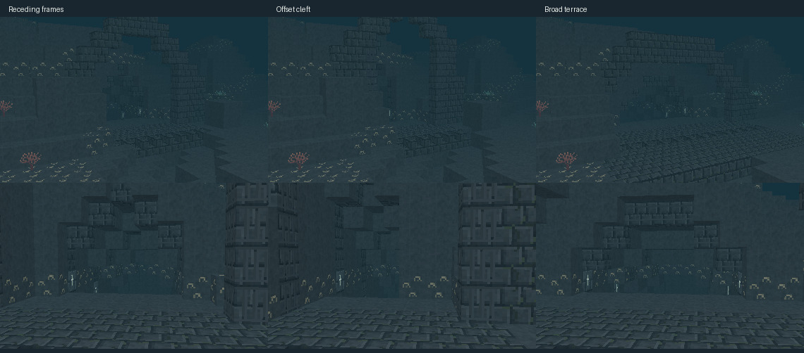
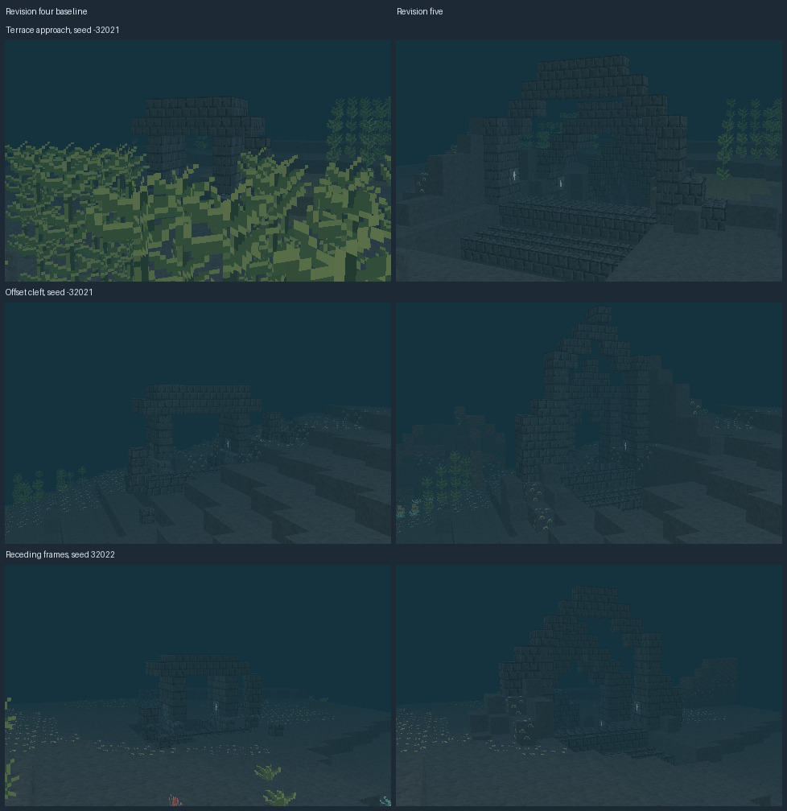
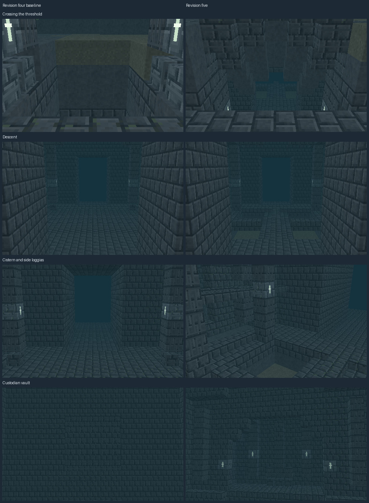
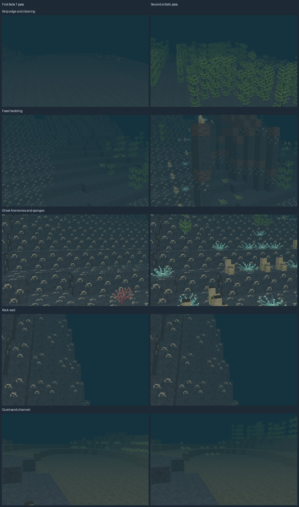
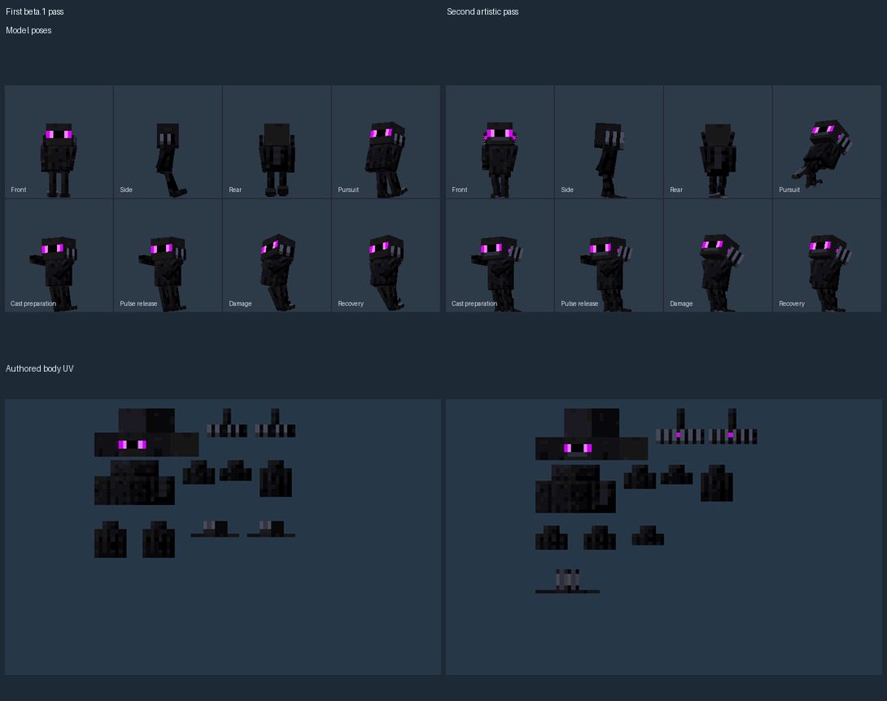
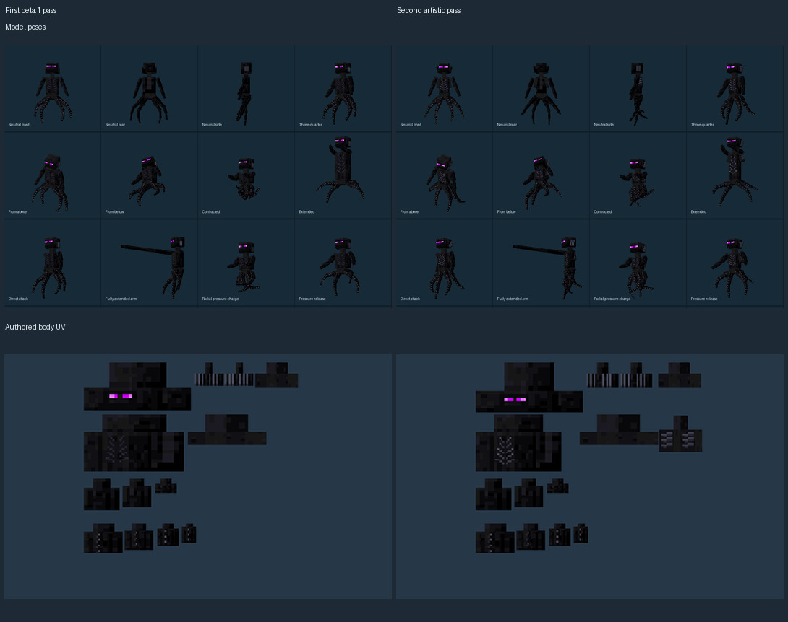

# The Beauty of the Abyss

The second artistic pass keeps the product at `0.5.1-beta.1`. It follows the owner's qualified alpha.4 acceptance, which asked for beauty and mystery to draw the diver toward the ruin. Revision four established flooded access and the site survey. In its diver views, the shallow frame reads before the geology, while the descent and encounter chamber offer little change in scale. The separate fossil spurs and the mostly upright creature poses also leave too much of the encounter looking familiar. [Owner direction](../engineering/abyssal-custodian.md)

## Observatory

Three voxel studies explored receding frames, an offset cleft and a broad terrace. The frames gave the strongest sense of distance, the cleft let one rock shoulder obscure part of the masonry, and the terrace provided a readable entrance on a flatter shelf. Revision five uses the same sequence of thresholds with different proportions, sightlines and rock shoulders. The site survey determines how the entrance meets the relief and freezes the result in its record.

The central crossing over a sediment basin and the side loggias make the cistern legible from several heights. A lower connector leads to the wider Custodian vault. Wall ribs and a recessed apse give the vault depth while leaving the central water and both entrances available for combat. The first generated study exposed stepped ribs that touched at corners. The final arches use overlapping courses and a native support check.

## Trench and creatures

Kelp follows a broad canopy field with winding gaps. Petrified banks and escarpments have curved crests and exposed strata shared across chunk slices. Algae and sponges sit low against the rock, and the deepest visible colonies concentrate the Ghost Anemones around pockets of substrate. Bare sediment and water separate larger compositions. The protected terrain envelope and the Mask's rendering path retain the owner-approved behavior.

The Enderkin now banks through turns and kicks through articulated shins and fins. Its gills, body and recovery read separately from the right-hand casting rig. The Custodian's deeper head and ribbed mantle use the same family pixels as the Thief and Saboteur. Its tentacle stroke travels along the chain, with body motion and turns carrying through to the ends. The model uses the native scale during Compression.

[Enderkin swim, turn and casting cycle](images/abyss-beta1-second-pass/enderkin-motion.gif) · [Custodian movement and Compression cycle](images/abyss-beta1-second-pass/custodian-motion.gif)

The perspective plates use native generated block IDs, metadata and block light with the shipped 16-pixel atlas, fixed fog and offline geometry. The creature plates and sequences capture the compiled Java models and UVs with controlled action inputs. In-client OptiFine appearance, Mask contrast, visual timing and positional audio remain owner playtest items.

## Owner save

Open **ZTO Beauty of the Abyss - Second Pass** in Tekkit Dev. Start on the diving platform in Creative and take the Mask, Flippers and charged Tank from the chest. Use **Spawn Eggs** in the marked open-water area. Switch to Survival to exercise the legitimate site Custodian. The save uses seed `-32021` and includes `Dive locations.txt`.

| Location | X, Y, Z |
| --- | --- |
| Diving platform | 3368, 65, -4268 |
| Approach to the Observatory | 3373, 28, -4268 |
| Open water for Creative Spawn Eggs | 3386, 55, -4280 |
| Kelp canopy | 3438, 42, -4290 |
| Fossil formation | 3311, 38, -4235 |
| Ghost Anemone habitat | 3406, 28, -4309 |

| Seed | Generated approach | X, Y, Z |
| --- | --- | --- |
| -32021 | Terrace | 3370, 27, -4268 |
| -32021 | Cleft | -3371, 38, -2915 |
| 32022 | Terrace | 4846, 28, -3288 |
| 32022 | Terrace | 4796, 34, 2403 |
| 32022 | Receding frames | 4760, 29, 2830 |
| -32022 | Terrace | 2333, 36, -2223 |

## Compatibility

Revision five preserves historical plans one through four and uses the same site identities and chunk stamps. The wider footprint applies only to a new reservation. Saved worlds keep their generated blocks and existing encounter records. The finite patrol policy, five Custodian attacks, native physical Compression, manual eggs, legitimate one-time pearl and EE2 scarcity remain on the pinned pack paths.

The native survey sampled 1,444 cells across four seeds. All six suitable sites generated complete, flooded revision-five Observatories with two routes to the Custodian. The native checks also exercised connected entrance courses, lamp light across slices, four historical layouts, reload after player edits, eviction and reward persistence. Trench probes on seeds `32021` and `32022` found zero excavation-induced chunk steps or residual pillars, and verified reverse generation order, Anvil reload and subsequent Tekkit population. Focused fixtures also passed marine placement and refill, equipment and Mask fog uploads, Motorboat and Distillation. The local marine inset can still leave narrow gaps where dense habitats cross chunk edges.

The canonical MCP 6.2 client compilation, reobfuscation and archive verification installed the `local-dev` pair in Tekkit Dev. The four approved machinery PNGs match the previous packaged bytes and every pinned hash. The mod records source commit `29186880d49c0c75e0f314eff926fdaa403d5ce4`. The provenance sidecar includes the workspace dirty flag because review files were present during the build.

| Installed artifact or fixture | SHA-256 |
| --- | --- |
| `ZedsTekkitOverhaul.jar` | `95d96f52fd644d3827b5a4a74217c82dc9ce7c230232fae2783e51413c6bbc22` |
| `ZTOAgent.jar` | `c2546fb64183ed3b3fce0dace0e0ad325b59d3b564cc02e806be09fbc1b64679` |
| `local-dev` artwork fingerprint | `12d92618fbba858abb08b0d5356ac22a3b56b7265509bcbc514fb467905ef587` |
| Disposable save ZIP | `aba7ce41dcee9065847baca514d1839a7aae82753bef26cfd6957a024cc5caa4` |
