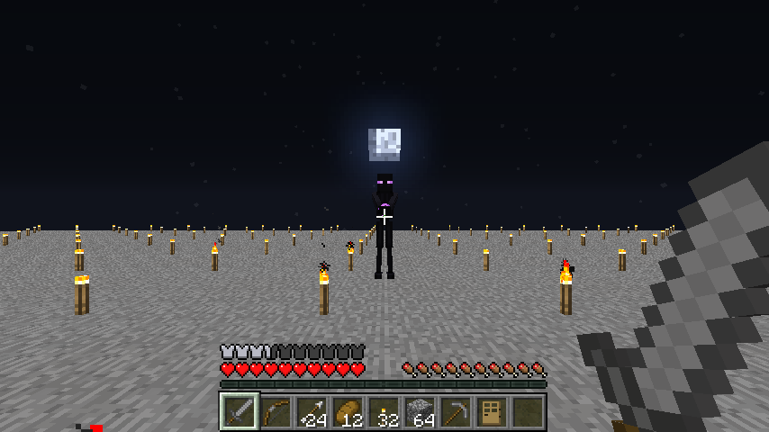

# Survival 0.1.0-alpha.8 — Experimental Enderkin encounters

Set `experimentalEnderkinEncounters=true` in Tekkit Dev's `minecraft/config/ZedsTekkitOverhaul.cfg` and restart. The default is `false`. Use a disposable Survival save in the Overworld with the normal patrol or player assault setting enabled. Natural dusk still starts each window. The spawn eggs work with either config value.

| Existing encounter | Default allocation | Optional substitution |
| --- | --- | --- |
| First-quarter patrol | 2 | Ordinary composition |
| Waxing-gibbous patrol | 3 | 25% selection chance for one Skirmisher |
| Full-moon wave 1 | 4 | Ordinary composition |
| Full-moon wave 2 | 5 | 50% selection chance for one Skirmisher |
| Full-moon wave 3 | 6 | 40% selection chance for one Breacher |

Selection uses separate deterministic rolls from the world seed, logical lunar day and wave index. Wave selection needs a positive base allocation. Selected species receive the first available slot and spend up to four **existing** candidate attempts. Four failures return that slot to ordinary composition, even within the same retry batch if attempts remain. A selected slot expires with its wave or patrol. The existing carry can transfer one unspent ordinary allocation to the next wave. Enderkin do not take equipment rolls. The assault remains capped at 15 by default, with an active cap of 8 and nearby hostile cap of 28. A nearby Breacher also blocks another Breacher substitution.

## Placement and lifecycle

The existing annulus, loaded-chunk guard, open sky, terrain, player separation, physical collision and light checks apply. Enderkin require the two alpha.6 outward approaches even when the artificial-light exception is off. Placement needs 2.8 blocks of vertical clearance and a centered width of 1.04 for Skirmishers or 1.70 for Breachers. The 16-block tactical range is measured in three dimensions, so higher ledges or an extended assault radius can make a candidate unsuitable. The check uses existing world collision boxes. It does not predict later animation clipping, future water flow or every path through the terrain.

An inserted Enderkin initially pursues the encounter player. A wall can prevent a Skirmisher from firing and give a Breacher an obstruction to approach. Existing range, line of sight, navigation retries, and give-up timers remain in charge. The existing Ender Pulse moves 0.82 blocks per tick for up to eighteen steps, deals 2 HP base damage with normal mitigation, and can hit an intervening living entity. Breacher pressure remains non-destructive and excludes TileEntity-bearing blocks. Vanilla doors, fence gates, opaque blocks and fences use existing behavior. Modded barriers can block movement without qualifying for a pressure animation.

Population caps act before new placement attempts. A capped or expired assault wave keeps the existing close and carry rules. Patrols can finish early at the local cap. The encounter follows the existing pause, death, difficulty-change and replay rules. Peaceful aborts placement and uses vanilla hostile removal. Saved mobs can persist across reopening as ordinary entities. The director does not restart an interrupted assault or restore transient attack targets from its old world. Enderkin remain absent from biome spawn tables and carry no item drop or new progression resource.

## Diagnostics and reproduction

Survival Debug shows the selected role, attempted candidates, insertion and rejection categories for each selected slot, plus tracked assault Enderkin. The existing read-only `assault.snapshot` adds `experimentalEnderkin`, `activeAssaultEnderkin`, `patrolEnderkin` and `waves[].enderkin`. Each slot exposes ordinary insertions as well as the special result. The bridge and HUD are optional.

After deploying to the isolated fixture copy, run the alpha.6 runner with the `ender-first`, `ender-gibbous`, `ender-waves`, `ender-fallback`, `ender-cap` and `ender-peaceful` modes. Each mode launches the actual pack in a marked disposable save. The two-role assault uses the second full-moon cycle of the stock fixture seed. The harness seeds candidate sampling, advances to before dusk, and lets the natural transition start the production director. The runner uses a private copy for settings and leaves the staging instance intact. The original modes run with the experiment off.

## Owner checklist

- Compare the same moon and arena with the option off and on. Start with an open unlit field and basic equipment, then add lights, cover and an escape route.
- Observe the Skirmisher before and after closing distance. Record whether charge and release remain legible around other hostiles, and whether cover and movement give enough reaction time.
- Put an entry and an alternate path on a walled perimeter. Check whether the Breacher approaches normally, when it stops at the barrier, and whether opening it creates a readable change.
- Repeat on stepped terrain and around a representative Tekkit compound with advanced equipment. Inspect the entrance, machines and inventory contents after combat. Keep the opt-in default until combat pacing and modded barrier behavior are accepted.

## Tekkit Dev evidence

Production sources are recorded in `2456717ecef87acb12b6d6e060e807892a3eddcb`. The MCP compile, reobfuscation and 289-entry streaming archive check passed on the candidate built from those changes over `debfc9399c8dad69b2b33d1e65ae7f84b2aa7c47`. The local integration archive SHA-256 was `ed223cd2ed97da499646cc44596f76f4f54c822ef44a6ed917829762c264dd38`. The isolated client used Minecraft 1.2.5, Forge 3.3.8.164, FML 2.2.106.176 and Java 8u504 with debug HUD, lunar debug key, verbose lunar logging and Dev Bridge disabled. The copied profile still logged the pre-existing EMC warning for item ID 169.

- The enabled first-quarter patrol inserted two ordinary mobs. The waxing-gibbous patrol inserted three, including one Skirmisher on the second attempt after a sky-light rejection. The roof fallback rejected four Skirmisher attempts, then filled three ordinary slots after the fixture removed the roof. A separate 28-hostile saturation fixture stopped before the first placement attempt. Switching to Peaceful cancelled the selected patrol before it could insert a mob.
- The lit full-moon fixture inserted 4/5/6. Wave two inserted a Skirmisher on attempt one. Wave three inserted a Breacher on attempt two after a sky-light rejection. The probe placed the player at combat distance after insertion and aligned the spawned Breacher with a controlled doorway. It observed a natural Pulse and Breacher door pressure with the closed panel intact, then checked same-night replay protection. This controlled encounter is evidence of distinct tactical behaviors.
- The installed pack rejected water, a transparent roof, a protected courtyard, a narrow cell and a trench edge. Six individual placement probes took approximately 25–956 microseconds each in that fixture. These single samples are a smoke check rather than a frame-time benchmark.
- The direct Breacher obstacle probe triggered pressure for closed wooden and iron doors, a closed gate and stone. An open door, open gate, sampled isolated fence, chest and RedPower block breaker produced no pressure. The fixture checked block IDs, post-placement metadata and tile identity before and after the pressure call. Full movement through varying fence layouts and powered access circuits still needs a playtest.
- With Enderkin disabled, all six original alpha.6 runtime modes passed. The probes checked the native pause menu and patrol resume, lit outdoor placement and protected interiors, ordinary full-moon waves of 4/5/6, same-night replay protection, a quiet new moon and vanilla light rejection when the outdoor-light exception was also disabled.
- The alpha.7 pulse, combat, visual, stress and both Creative modes passed against the same archive. Stress observed 138 tick transitions in 7.447 seconds with 12 active prototypes. Portable calendar, scheduling and approach checks passed, including 10,000 deterministic seed/cycle pairs for species selection and fallback.



[Breacher at the controlled entrance](images/alpha8-mixed-pressure.png)

The remaining owner question is whether the two roles produce readable decisions during unrestricted fights with basic and advanced gear. Keep the experiment off by default while collecting that feedback. Working RedPower access circuits, a full compound fight, alternate routes and live client behavior at unloaded terrain boundaries still need scenario coverage.

## Configuration regression

Deploy using the isolated copy described in [alpha.5 reproduction](survival-alpha5.md#reproduction). The PowerShell runners clone the staging instance into unique directories below `dist-zto/survival-hud-runtime/runs`. The original config remains in place even if a runner is interrupted. Each child client uses its own settings, save and reports. Do not run two graphical clients concurrently when checking gameplay timing.

```powershell
.\zto-tools\test-config.ps1
.\zto-tools\test-config-runtime.ps1
.\zto-tools\test-alpha5-runtime.ps1 -TemplateSave <marked-disposable-save>
.\zto-tools\test-alpha6-runtime.ps1
.\zto-tools\test-alpha6-runtime.ps1 -Modes 'ender-first','ender-gibbous','ender-waves','ender-fallback','ender-cap','ender-peaceful'
foreach ($mode in 'combat','pulse','visual','stress','creative','creative-native') {
    .\zto-tools\test-alpha7-runtime.ps1 -Mode $mode
}
```

The startup runner verifies a fresh file, FML's pre-init rename, old Forge and EMC migration, exact backup bytes, customized registrations, conflicting canonical edits and an unchanged restart. Both harnesses use isolated data. To reproduce a migration manually, start with a disposable copy and keep pre-upgrade copies of the five settings files and optional EMC profile. Remove the canonical migration marker only in the disposable fixture when exercising an unversioned Properties input. Use [the migration guide](configuration.md) for precedence and valid settings.

The configuration candidate was built from production source commit `efe87fc2ce793678e7e8faa4715dc697cad57f36` with MCP 6.2 and Forge 3.4.9.171. The archive SHA-256 was `176fe3f401cd2c1a6b91d73cbd176f69a5557e069b1ee78726fde125fd8de808`. The sidecar marks the workspace dirty because the test and documentation changes were in progress and unrelated untracked files were present. The 293-entry archive passed reobfuscation and streaming validation. The staged pack used Forge 3.3.8.164, FML 2.2.106.176 and Prism Java 8u51 for these runs.

Five startup cases passed on this candidate, including FML's backup rename, a preserved custom Foundry ID and a Windows sharing lock that prevented replacing the canonical file. The locked file stayed byte-identical and startup used the read settings. The third-party comparison found only pack-generated timestamps or property ordering changes. Bed anchor and vanilla sleep probes, the six original alpha.6 modes and all six alpha.7 modes passed, including both Creative catalogs. The inventory agent verified the NEI-patched dispatcher. Portable configuration, lunar scheduling, encounter selection, crafting UX, drag policy and EMC tests passed.

The extended `ender-first` geometry fixture rejected an unloaded candidate without loading its neighborhood. The barrier probe checked serialized TileEntity state across the pressure call, including a chest containing 17 iron ingots and the installed RedPower block breaker. Those checks cover placement and direct pressure in the staged fixture.

### Owner scenarios

- In a marked save, build an L-shaped wall with a closed iron door and an alternate opening several blocks away. Spawn a Breacher at the front of the wall with a damageable Survival player inside its 16-block range. Record the route taken and compare with the alternate route blocked. Repeat with the entrance opened under normal redstone power.
- Repeat with a RedPower-powered entrance in the same compound. Verify that its open/closed state controls movement and record any unintended obstruction. Place a disconnected RedPower block breaker and a marked chest nearby, record metadata and inventories before the fight, then compare after Save and Quit and reopening.
- At a live render-distance boundary, record whether a pursuing Breacher disengages as the player leaves its loaded area and reacquires only after eligible approach. Repeat near stepped terrain. The automated boundary fixture checks the spawn gate with a known unloaded chunk. It does not exercise roaming navigation.
- In a disposable crafting GUI use a recipe with missing ingredients. Compare Alt-click with `partialRecipeFill` enabled and disabled on separate launches. Hover the recipe action and press the configured `craftingUxShortcut`. Open Lunar Debug and Survival Debug on their configured keys and inspect the history capacity after repeated events.

### Deferred work

Powered access behavior and long-running unrestricted fights need owner observation. Tactical navigation still depends on the installed legacy pathfinder and loaded world provider. The launch harness uses an assembled pack classpath and obfuscated names tied to Minecraft 1.2.5. Territorial activity, settlement recognition and their save formats remain future design work. Keep any future threat assessment at the encounter admission boundary described in the [territorial design contract](territorial-threat-design.md).

## Recurring PLAYER_ASSAULT

Run `zto-tools/test-alpha6-runtime.ps1 -Modes assault-recurrence` in the isolated staging profile. The fixture uses an open lit arena, a damageable Survival player and bounded hostile cleanup after each wave. The first dusk advances naturally from the fixture's saved time. To shorten subsequent cycles the runner jumps to 160 ticks before the corresponding full-moon dusks, then lets the normal game loop cross each boundary. The portable calendar test supplies every intervening tick across two complete eight-day cycles.

The natural full moons at raw ticks 13,000, 205,000 and 397,000 each started an encounter. Each initialized all three waves, placed 15 hostiles and resolved with `WAVES_COMPLETE`. Rewinding before the first dusk and recrossing yielded `RESYNC/REPLAY_SUPPRESSED`. Save and Quit and reopening on the third night restored the consumed boundary with zero starts in the new session.

The installed NEI local time setter jumped inside the next full-moon night and produced `RESYNC/TIME_SKIP`, with zero starts. This is intentional. A skipped boundary should not create a missed encounter. To reproduce a later eligible assault, set the time before dusk and allow ordinary ticks through 13,000. The installed NEI hour controls advance the raw day as well as the time of day, which can also change the lunar phase. The lunar debug phase control changes the alignment without moving vanilla time. Align before dusk and wait for the natural event. The fixture did this at 613,000 after the previous save/reopen.

The calendar stores a replay watermark. The director persists its separate most recent consumed raw boundary and an open flag. Resolved and interrupted encounters can be followed by later admissions. Peaceful and a Creative player reject dusk without consuming an assault. The recurrence fixture reports event kind and cause, phase, raw time, eligibility, consumed boundary, starts, wave state and placement results. Optional HUD history distinguishes a calendar boundary from encounter admission. The investigation reproduced intentional skip suppression and required no scheduling or persistence change. See the [maintenance review](alpha8-maintenance.md).

### Stabilization candidate evidence

The stabilization build used production source `3d487af20df63b6ab134cb10b02ca7e493653bf8` and archive SHA-256 `5b2c6b372e50cc122b77404133e9509865f20f79ee7c30bc0d29fea6515f07b7`. MCP 6.2 client compilation, reobfuscation and streaming validation of 293 entries passed. The runtime used Forge 3.3.8.164, FML 2.2.106.176 and Prism Java 8u51. The sidecar records pending test and documentation edits as a dirty tree.

The compiled recurrence fixture passed on this archive, including interruption replay and an Overworld → Nether → Overworld round trip while an encounter was active. The Nether run had no assault authority. On return, the Overworld retained the interrupted boundary and zero starts in the rebound director. The portable full-clock check covered every tick between three full moons. The runtime run accelerated only normal client ticks and used explicit skips for the cases described above.

All five configuration startup cases passed with effective music and effects at zero and no SoundSystem backend. The silent gameplay probes check those values throughout their render callbacks. Prism Hopper and distillation persistence probes passed with graceful shutdown and options restoration. The live 3×3 and 5×5 crafting and hotbar checks passed. The active Inventory Tweaks profile left the hard-protection check blocked. See [silent client launch](testing.md#silent-client-launch) for the test boundary.
