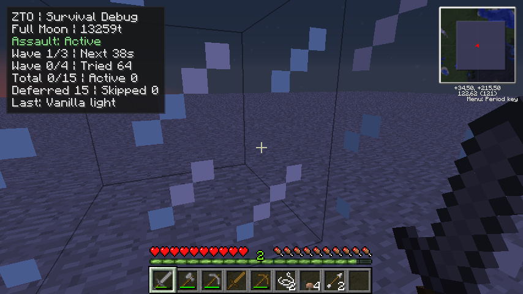
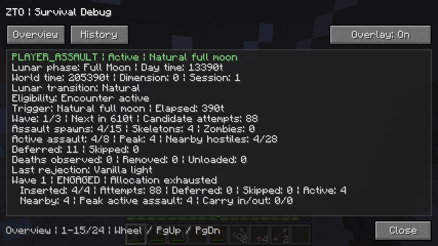

# Survival 0.1.0-alpha.2 gameplay pass

## Tuning and compatibility

The natural full-moon dusk still admits one local Overworld PLAYER_ASSAULT. The director uses simulation ticks, retains the existing consumed-night record, and leaves vanilla mobs in the world when spawning ends. The encounter budget and world save format are independent. SITE_SIEGE remains a future encounter with a different target.

| Property | Default | Bounds |
| --- | --- | --- |
| `playerAssault` | true | true or false |
| `assaultSpawnBudget` | 15 | 1–24 |
| `assaultWaveInterval` | 900 ticks | 400–1200 |
| `assaultActiveCap` | 8 | 2–12 |
| `assaultOuterRadius` | 16 blocks | 14–28 |

Existing configs retain an explicit `assaultSpawnBudget`, including the previous default of six. Set it to 15 to try the new baseline. The old `assaultPulseInterval` is superseded by `assaultWaveInterval` because pulse intervals are too short to use as wave intervals. The config is read when Minecraft starts.

- The first wave starts at 100 ticks. With surviving assault mobs, starts are normally 900 ticks apart. With none, the default interval drops to 450 ticks, with at least 80 ticks after the preceding spawn window closes. Default allocations are 4, 5 and 6. Each expires after 280 ticks. The director tries up to eight candidates once per 20 ticks and inserts at most one mob per retry. One unused slot can transfer to the next wave within the original budget.
- Budgets below three can leave empty wave slots. Use a budget of at least three when evaluating the three-wave cadence.
- The final engagement ends once tracked mobs are gone or 900 ticks after the last spawn window closes. Default maximum duration is 3,080 simulation ticks (154 seconds at 20 TPS), and the maximum configurable duration is 3,680 ticks. A lifecycle interruption closes pending allocation and does not purge mobs.
- Direct area sampling uses a 12–16 block horizontal annulus by default and accounts for rounding to block centers. Vanilla target acquisition has a 16-block range, sight checks and vertical overlap requirements. Larger radii trade placement options for slower or absent engagement. The surface must be within eight blocks vertically. The outdoor column rule excludes covered interiors, and the ordinary support, occupancy, collision, liquid and light checks still apply. A roof's exposed top is eligible if it meets the same checks. No path to the player is forced.
- The local safety cap is 28 living hostile entities in the player's vicinity (the bounding box expanded by 32 horizontal blocks and 24 vertically). Both caps are checked before every insertion. Waves on Easy and Normal start zombie-heavy and the final wave alternates skeletons and zombies. Hard retains skeletons to avoid vanilla Hard zombie door breaking.
- Active tracking checks the original references in loaded chunks. A nonpositive health observation is reported as a death, without attributing it to the player. Unload and removal are observations about membership, and despawn cannot reliably be separated from other removal. Reloaded entities no longer carry assault identity, but count toward the local hostile limit.

Natural spawns use a separate global creature budget and exclude positions within 24 blocks of a player or world spawn. This event has a local budget and player exclusion radius for deliberate nearby pressure. Its candidates still need valid support, vanilla hostile light, clear collision and a loaded surface column. The height limit and outdoor requirement can leave caves, steep hills, canopy, water and well-lit areas with little or no valid space.

These choices give shelter, light, walls, elevation and retreat mechanical value. The encounter uses ordinary combat rules and leaves the player free to use early equipment or industrial defenses. See the [future territorial contract](territorial-threat-design.md) for how local intensity could later be selected.

## Test build

- Tested source commit `52231aad91d422d5906be34c3a365951b417e657`.
- Built and deployed JAR SHA-256 `b8d23affdf2409aa6b620d2ad958f39f98700cb331c7be743ada788f7c27c93d`.
- Build timestamp `2026-11-12T08:39:11.2258402Z`.
- This historical test build reported product version `0.1.0-alpha.1` and a dirty tree because of the pre-existing untracked `docs/agents/TEST_AUTOMATION_SPEC.md`. The tracked code used the tested commit. The assault gameplay pass subsequently received the `0.1.0-alpha.2` identifier.
- MCP 6.2 client compile and reobfuscation succeeded under JDK 8, with Forge 3.4.9.171 in the MDK. The build streamed all 244 archive entries successfully. Portable calendar, assault scheduling and wave/HUD recorder checks passed.
- The same JAR loaded in a separate copy of the Tekkit Dev profile with the HUD off and all Dev Bridge flags false. Forge completed startup, the client opened no TCP listener, and it shut down normally.

## Comparison

Alpha.1 observations below come from the documented [Hard Survival runs](survival-assault-acceptance.md) and [HUD acceptance](survival-debug-hud.md#alpha1-acceptance-on-2026-11-12). They used different terrain and difficulty from the Normal alpha.2 arenas, so the counts are observations rather than a controlled difficulty comparison.

| Measure | Alpha.1 | Alpha.2 |
| --- | --- | --- |
| Duration at 20 TPS | 420 ticks, 21 s | Up to 3,080 ticks, 154 s, at default settings |
| Default budget and distribution | 6, split 2/2/2 | 15, split 4/5/6 before carry-over |
| Wave starts with surviving mobs | 100/260/420 ticks | 100/1000/1900 ticks |
| Observed insertions | 3 in the original runtime run; 2 in the HUD run (0/0/2) | 10 (3/5/2) in the first full three-wave observation on open terrain |
| Rejections | HUD run had 57 attempts: 33 outside the annulus and 22 light or collision failures | The 10-insertion run had 128 attempts: 118 vanilla light failures, plus 21 active-cap stops before trying a candidate |
| Peak active assault mobs | Unmeasured | 8 in the 10-insertion run |
| Protected terrain | No matched historical run | See the arena observations below |

In the 10-insertion run, two assault deaths were observed without attribution. All three spawn windows completed. The player died during the final engagement at elapsed tick 2,888 and the event stopped with `PLAYER_UNAVAILABLE`. The saved health was below zero. The runner expected normal resolution and flagged this run at the terminal-state assertion.

## Tekkit Dev arena observations

The live runs used Minecraft 1.2.5, Forge 3.3.8.164, FML 2.2.106.176 and Java 8u51. Each began in Normal Survival on a separate copy of a marked save with seed `-7184827518270584220`. The copies started before dusk on a high, flat arena to isolate placement from underground mobs. The bridge aligned only the lunar phase. Vanilla time reached dusk at raw tick 205,000. The tested config used the 15-mob budget and the other default wave settings.

| Arena | Live observation |
| --- | --- |
| Open annulus, glass booth in the center | Three waves inserted 3/5/2. Peak active was 8. The player died before the final engagement deadline. Scenario report `688995567620423.json` contains a separate run that reached all three wave windows with 8 inserted (4/4/0) before the bridge was interrupted. |
| Illuminated, enclosed annulus with a glass roof | 0/0/0, with 112 `NOT_OPEN_TO_SKY` rejections per wave, 15 slots skipped and peak active 0. The waves started at 100/550/1000 ticks and resolved at 1280 ticks. The placement scenario passed. During automated shutdown Inventory Tweaks threw in `cloneHotbar`, which blocked that copy's restart check. |
| Shallow water across the entire annulus | 0/0/0, with 112 `UNSUITABLE_GROUND` rejections per wave, 15 slots skipped and peak active 0. The run reached the same 1280-tick resolution. The placement scenario passed. Automatic restart hit the same Inventory Tweaks shutdown error. |
| Open annulus with 20 vanilla zombies in a pen within the local population radius | 4/3/0, with 108 attempts, 100 vanilla-light rejections, one occupied site and 24 local-cap stops before candidate sampling. The cap allowed insertions above the old limit of 16 and stopped new ones when the population reached 28. Vanilla later took the sampled total to 30. Peak active assault was 7 and the encounter resolved at the 3080-tick timeout. |

The crowded run verified the running archive hash on both launches. Save/Quit closed cleanly and a new Java process reopened the same copy and night. The bridge reported boundary 205,000, `RESOLVED / NIGHT_CONSUMED`, zero starts and zero insertions. Both processes exited normally.

The same archive also rendered the compact HUD, Overview and chronological History at 854×480 in a separate Hard Survival copy with the bridge off. The probe checked that Escape pause held the encounter at elapsed tick 260 until resume. It invoked the ordinary Save and Quit to Title action during the encounter, then reopened the same copy. The state was `ABORTED / INTERRUPTED_ON_REOPEN`, the consumed boundary was still 205,000, and the new session had zero starts and insertions. This HUD copy logged a separate EMC profile warning for an unregistered item; the probe continued through the assault and reload.

| Overlay during the first wave | Overview after its spawn allocation was exhausted |
| --- | --- |
|  |  |

Local evidence is under `dist-zto/test-reports/`. The lifecycle report filenames end with `5af71986398c4854a2507f7686103316` (open), `ba5b6c7c4e6c45a0bc857e24b2cf9ef0` (shelter), `774a67822e63469ca347081caec17301` (water) and `e9c8fd6d67a04beea7eb50ad5e327b6e` (crowded and restart).

These observations support keeping the cap and retry window for the first owner trial. The start of dusk cost most of the open run's candidates to vanilla light, yet retrying placed mobs in the first wave. If survivors occupy all slots, the final wave can place few or no reinforcements. Owner play should establish whether the climax is recognizable when the earlier waves are cleared and whether enemies reach the player in real terrain. The unattended tests establish placement and budget behavior. They did not instrument chunk generation, measure sound audibility or exercise every portal, bed and clock-resync case.

## Owner playtest world

With the Tekkit Dev client closed, run the generator from the MDK root after a client build. It uses JDK 8 and the MCP NBT classes in `bin/minecraft`.

```powershell
.\zto-tools\new-assault-playtest.ps1
.\zto-tools\new-assault-playtest.ps1 -Name 'Lunar Assault - Shelter'
```

By default it writes a new save under the Prism **Tekkit Dev** instance. Use `-SavesDirectory` for an existing scratch directory or a custom Tekkit Dev save location. Choose a different name if the destination folder already exists. The generator writes the Minecraft 1.2.5 Anvil save header and lunar state. The game generates terrain on first open.

The preset starts on open terrain at X 34.5, Z 215.5, with seed `-7184827518270584220`. It starts in Survival at tick 10,800 with a full moon aligned for natural dusk at tick 13,000, about 110 seconds later at 20 TPS. The hotbar contains a stone sword, bow, 24 arrows, 12 bread, 32 torches, 64 cobblestone, a stone pickaxe and a wooden door. Leather armor is equipped.

Difficulty is a client setting. In **Tekkit Dev**, select **Normal** and set `playerAssault=true`, `assaultSpawnBudget=15` and `survivalDebugHud=true` in `config/mod_ZedsTekkitOverhaul.cfg` for the comparison. The generator leaves client settings alone. Use F10 for details and Shift+F10 to toggle the overlay. The Dev Bridge is optional for a manual trial.

1. Fight in the open. Compare with an ordinary night. Note when each wave actually arrives, how many mobs reach or shoot at you, how long the gaps feel, and whether the final wave reads as a climax. Record attempts, insertions, active mobs and missed allocation from F10.
2. Use a fresh copy to build a modest lit shelter with a roof, door and retreat route before dusk. Compare interior safety, roof and perimeter spawns, and whether the shelter buys recovery time. Try a wall or moat, a simple trap, or retreat.
3. Use another copy on a shoreline or hillside. Check that the HUD explains rejected placements. Record whether the encounter feels distinct, readable, threatening and fair with the starter equipment.

## Automated verification

The generator was verified with the [test build](#test-build) in a copy of Tekkit Dev on Normal. The client loaded the preset at tick 10,800 in full moon, started one natural assault at tick 13,000 and inserted its first mob at tick 13,200. All 12 starter stacks were still present after Save and Quit. A second generator call with the same name refused to replace the existing save.

Run the existing lifecycle on a marked daytime fixture in the isolated Tekkit Dev instance.

```powershell
.\zto-tools\test-lunar-calendar.bat
.\zto-tools\build-and-deploy.bat
javac -cp bin/minecraft -d dist-zto/lunar-tests zto-tools/assault-tests/AssaultDiagnosticsSelfTest.java
java -cp 'dist-zto/lunar-tests;bin/minecraft' zed.tekkitoverhaul.assault.AssaultDiagnosticsSelfTest
.\zto-tools\test-tekkit-dev.ps1 -DisposableSave <marked-save> -Persistence Assault -SkipCore -AssaultMinimumSpawns 8
```

Use a separate copy for each terrain setup. Use `-AssaultMinimumSpawns 0` for deliberately protected or unsuitable terrain. Use `-InterruptAssault` with the open fixture to exercise interruption before normal resolution. The runner verifies the running archive hash, one natural boundary, spawn and retry bounds, per-wave accounting, and the consumed night across a graceful restart.
