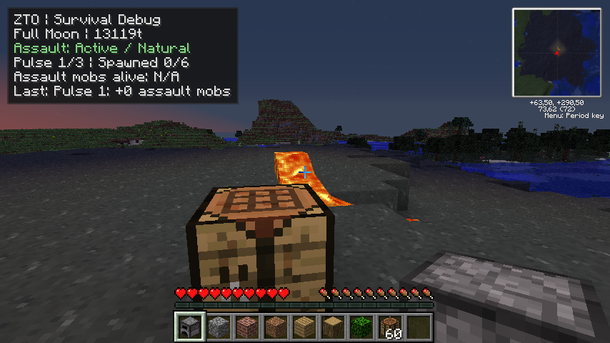
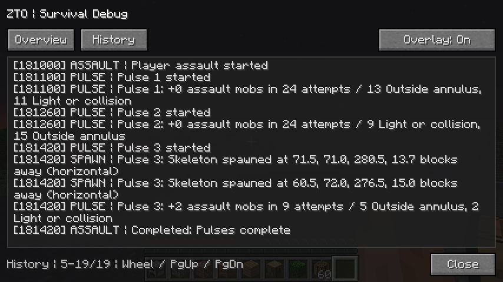

# Survival Debug HUD

Set these properties in the local client's `config/mod_ZedsTekkitOverhaul.cfg` while Minecraft is closed.

```properties
survivalDebugHud=true
survivalDebugHudKey=68
survivalDebugLogCapacity=250
```

The HUD defaults to off. The default shortcut is **F10** (LWJGL code 68). A value of 0 disables the shortcut. The history capacity is clamped to 20–300 entries. If the configured shortcut duplicates Lunar Debug at startup, Survival Debug uses F10 or F9 if Lunar Debug already uses F10.

- Press **F10** to open or close the detail screen, or **Shift+F10** to toggle the overlay during play. The detail screen also has an overlay toggle. Collection continues while the overlay is hidden.
- **Overview** shows the lunar clock and last transition, eligibility, assault status, attempts, rejections and successful spawns. **History** displays entries in observation order, newest at the bottom. Use the wheel or Page Up/Down, and Home/End to jump to an edge.
- The overlay appears in the upper left in a supported local Overworld. It yields to other screens, F1 and the F3 debug display. The detail screen keeps local simulation running.
- The log reports successful `PLAYER_ASSAULT` insertions with their pulse, initial coordinates and horizontal distance. The pulse summary counts rejected candidates by reason. A local cap rejection stops a pulse before the next candidate attempt, so it is counted as a cap stop. Vanilla combines light and collision in one spawn check.
- The history is memory-only and scoped to the open save. A dimension transition is recorded in the same session, with the interface hidden outside the Overworld. Reopening a world starts a new history and reports a persisted assault interruption when the director detects one.

The HUD consumes the existing lunar events and assault evidence on the game thread. It runs with the Dev Bridge off. Alive and ordinary-hostile counts are unavailable. The recorder tracks successful insertion only, without scanning entities, attaching persistent tags or inferring kills. Log export is deferred.

## Verification

Run these checks from the MDK root with JDK 8 on `PATH`.

```powershell
.\zto-tools\test-lunar-calendar.bat
.\zto-tools\test-dev-bridge.ps1
.\zto-tools\build-and-deploy.bat
javac -source 8 -target 8 -cp bin/minecraft -d dist-zto/lunar-tests zto-tools/assault-tests/AssaultDiagnosticsSelfTest.java
java -cp 'dist-zto/lunar-tests;bin/minecraft' zed.tekkitoverhaul.assault.AssaultDiagnosticsSelfTest
```

The focused recorder test covers event order, aggregated rejections, immutable history, bounded eviction and save isolation. The calendar and bridge suites cover the existing scheduling and observation contracts.

For a manual check, start a disposable local Survival save in Tekkit Dev. Align the calendar to full moon in daylight using Lunar Debug and let the game reach tick 13,000 naturally. Compare the compact count with the successful entries in History. Save and quit, reopen the same world, and check that the old log and counts are gone. Repeat with the Dev Bridge JVM flags removed to verify the standalone UI.

## Acceptance on 2026-11-12

The MCP 6.2 client compiled and reobfuscated with JDK 8 and Forge 3.4.9.171. The build script verified 241 archive entries and deployed the final candidate to Prism Tekkit Dev. Candidate SHA-256 is `1fea86990f11e75f75d3251122b4ed2fbe8d54b33a1f8b2ff4ebeb96cb31b4eb`. The calendar, assault schedule, recorder and bridge checks passed.

- **Default startup.** Prism Tekkit Dev reached the title screen with 44 mods loaded and `survivalDebugHud=false` on the initial candidate.
- **Live HUD.** The final candidate ran in a disposable copy of the installed Tekkit Classic 3.1.2 runtime (Minecraft 1.2.5, Forge 3.3.8.164, FML 2.2.106.176, Java 8u51), launched with the bridge disabled. The disposable Hard Survival save began at raw tick 180,920, aligned to full moon. The normal game clock reached dusk at 181,000. The first two pulses placed zero mobs. The third placed two skeletons at 13.7 and 15.0 horizontal blocks. The encounter closed after three pulses and 57 candidate attempts. History included the actual successful insertions and one aggregate outcome per pulse.
- **Controls and lifecycle.** A client-side probe exercised the registered shortcut callback, detail close handler, overlay toggle and Home/End scrolling. It captured actual game frames at 854×480 with the Auto and Small GUI settings. Saving, unloading and reopening preserved boundary 181,000 and produced a fresh history with zero new starts and spawns. Physical keyboard and mouse input, other resolutions and a human Survival session remain manual checks.

| Compact overlay during pulse 1 | Detailed history after pulse 3 |
| --- | --- |
|  |  |
