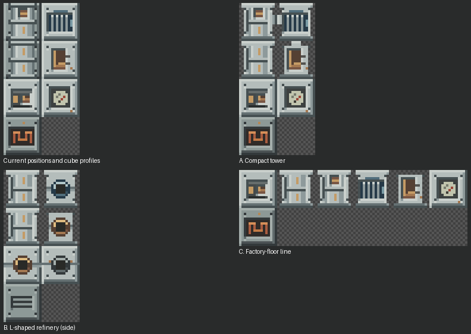

# Fractional Distillation layout alternatives

These are proposals for the existing six component types and seven placements. Rendered profiles use the published ZTO face atlas. The local preview command also works with the installed-pack derivative atlas. Each mockup is an orthographic study.



In the diagrams, letters identify Boiler (B), Heater (H), Column (C), Condenser (K), Receiver (R) and Thermometer (T). Stacks list top to bottom. Front access is toward the reader in each elevation.

## A. Compact revised tower

The shipped visual treatment uses this concept with the current formation rule.

```text
Plan, front edge       Front elevation
[C/C/B/H] [K/R/T]       +2  C K
                        +1  C R
                         0  B T
                        -1  H .
```

Two ground cells, four levels, seven placements. The player reaches the Thermometer and Receiver from the same aisle. The upper pipe crosses one block boundary and the neck enters the Receiver from above. Bring EU in from the left or below the Heater, crude in from an exposed Boiler face, cooling water into the outside Condenser face and extract from an exposed Receiver face. The access shown is a construction suggestion for the existing unsided liquid ports.

The coupled silhouette makes the strongest use of the vertical chamber. Height and top-level pipe access still matter below low roofs. Recognition, candidate count, lookup cost and old save compatibility match the established layout.

## B. L-shaped refinery

```text
Plan                     Side elevation
Front [C/C/B/H] [  .  ]  +2  C K
Back  [ K/R   ] [  T  ]  +1  C R
                          0  B T*
                         -1  H .
                           * T sits one cell to the right
```

Three occupied columns within a 2×2 footprint, four levels, seven placements. The Condenser and Receiver move behind the Column. The Thermometer moves one block sideways from the rear stack. A walk-around bay lets the player reach the Receiver from the rear and the Thermometer from the right. Feed water from the back and pull product sideways. The Boiler and Heater keep a clear front and left.

The depth change gives the vapor line a noticeable turn and allows piping to sit behind the front panel. A corner build can conceal the Receiver against a wall. Construction requires access on two sides. A future recognizer would rotate full X/Z offsets together and test ties between old and new matches. Each orientation can still use six bounded slot checks. Compatibility cost is moderate because two fluid ports and the Thermometer move and their visual neighbors change.

## C. Horizontal industrial line

```text
Plan, front edge                  Front elevation
[B/H] [C] [C] [K] [R] [T]          0  B C C K R T
                                   -1  H . . . . .
```

Six occupied columns within a 6×1 footprint, two levels, seven placements. Every access panel is at working height. Route a cable beneath the Boiler, oil into its end face, water behind the Condenser and a powered wooden waterproof pipe behind the Receiver. The floor must provide underfloor space at the Heater.

The process order is legible along an aisle. The line needs a larger floor area and gives up the visible rising column. It needs horizontal separator collars and an outlet connection at Receiver height. Recognition remains a short rotated offset list, but a six-cell span crosses chunk boundaries more often. Formation must account for unavailable chunks without loading them. This has the highest migration cost because the separator axis and three endpoint positions change.

## Recommendation

Keep A as the next owner review target. It conveys a rising vapor path with concrete connections and fits existing pipes, cables and saves. B is the stronger follow-up experiment if the owner wants more depth and a rear service side. C suits low factory ceilings when the horizontal silhouette is worth moving the process endpoints.

A later layout feature would need an explicit decision on whether to keep recognizing A alongside any new mode. That decision must cover ambiguous shared auxiliaries, partial batch and tank ownership, disassembly of old installations, and preservation of block and tile identities. This release uses the existing layout and requires no migration.

Run `python artwork/tools/distillation_previews.py` for front, side and top panels for all four versions, plus the current-layout operating states and GUI mockups. Local previews are written to `artwork/previews/`.
